<p align="center">
  
</p>

<p align="center">
  <samp>PYTHON · FASTAPI · OLLAMA · DOCKER</samp>
</p>

### <samp>01 — WHAT IT IS</samp>

A fully local multi-agent software foundry. You give it a goal; a team of specialised
agents plans the work as a dependency graph, writes the code, tests it in a Docker sandbox
and integrates the result. Everything runs on local models through Ollama. Nothing leaves
the machine.

The hard constraint is VRAM. The three models it uses do not fit in memory together, so
agent roles are decoupled from model weights and the models are swapped as the pipeline
moves from planning to design to coding.

### <samp>02 — THE AGENTS</samp>

| Agent | Job |
|---|---|
| Boss | Breaks the goal into an architecture and a task graph. Writes no code. |
| Function designer | Turns the approved architecture into function contracts |
| Worker | Implements one contract at a time |
| Unit tester | Tests what the worker generated, inside the sandbox |
| Integrator | Assembles components that passed their tests into the workspace |
| Supervisor | Steps in when the pipeline fails or a system error is raised |

Agents never call each other. They subscribe to an event bus and react to state changes,
so one agent blocking does not stall the rest.

| Phase | Model loaded |
|---|---|
| Planning | `llama3.1:70b-instruct-q2_K` |
| Design and supervision | `gemma2:27b` |
| Coding | `qwen2.5-coder:14b-instruct-q8_0` |

### <samp>03 — HOW IT RUNS</samp>

```
POST /api/start-project { goal }
        │
        ▼
      Boss ──► Architecture_Approved          (unload planning model, load design model)
        │
        ▼
Function designer ──► Function_Contracts_Ready (unload design model, load coding model)
        │
        ▼
     Worker ──► Code_Generated ──► Unit tester ──► Test_Passed ──► Integrator
                                        │
                              Docker sandbox (generated code only runs here)
```

- `core/event_bus.py`: message routing between agents
- `core/dag_tracker.py`: task dependencies, and which nodes are unblocked
- `core/hitl_manager.py`: human-in-the-loop checkpoints that pause a task until you approve or reject it with feedback
- `core/metrics_collector.py`, `core/database.py`: run metrics and project state
- `tools/sandbox_async.py`: an ephemeral Docker container where generated code is executed and tested
- `tools/model_manager.py`: structured output from each model, and the VRAM swaps
- `memory/`: workspace indexing and context tools, so agents do not need the whole project in their prompt
- `api/` and `frontend/index.html`: FastAPI, a WebSocket bridge and a live dashboard

### <samp>04 — RUN IT</samp>

Requires Python 3.11, Docker, and [Ollama](https://ollama.com/) running locally.

```bash
cd foundry-project/backend
pip install -r requirements.txt
python main.py
```

On start it checks Ollama at `127.0.0.1:11434` and pulls any of the three models that are
missing. They are large downloads. The API then listens on `http://127.0.0.1:8000`:

```bash
curl -X POST http://127.0.0.1:8000/api/start-project -H "Content-Type: application/json" -d '{"goal": "a CLI todo app in Python"}'
```

Progress is streamed over `ws://127.0.0.1:8000/ws/ui`.

### <samp>05 — DESIGN DOCUMENT</samp>

[`Main.txt`](./Main.txt) is the original architecture write-up: the reasoning behind the
event-driven design, the agent hierarchy and the memory strategy for 8 to 24 GB of VRAM.

<br />

<p align="center">
  <sub><samp>MORE WORK AT <a href="https://github.com/Deatron01">GITHUB.COM/DEATRON01</a></samp></sub>
</p>
